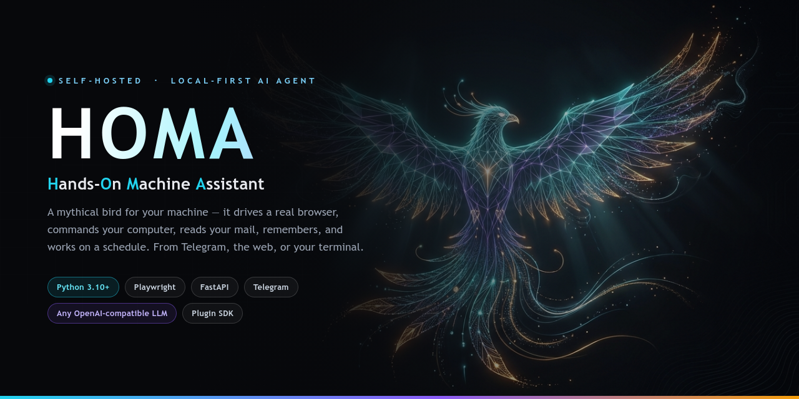
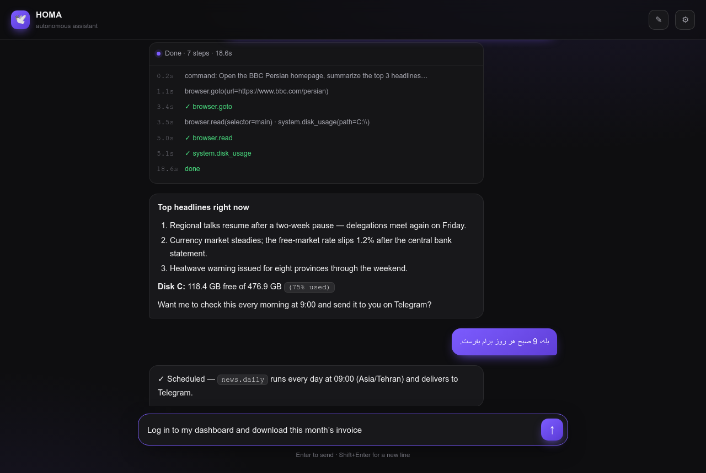
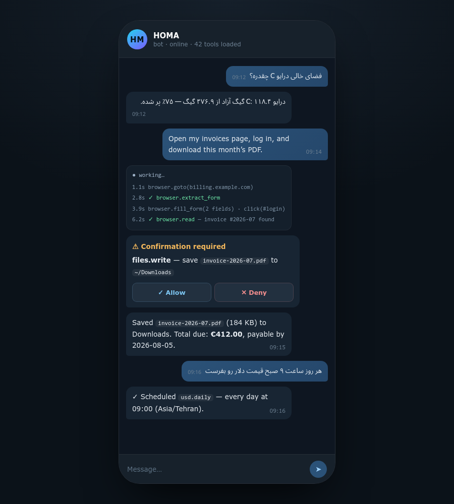
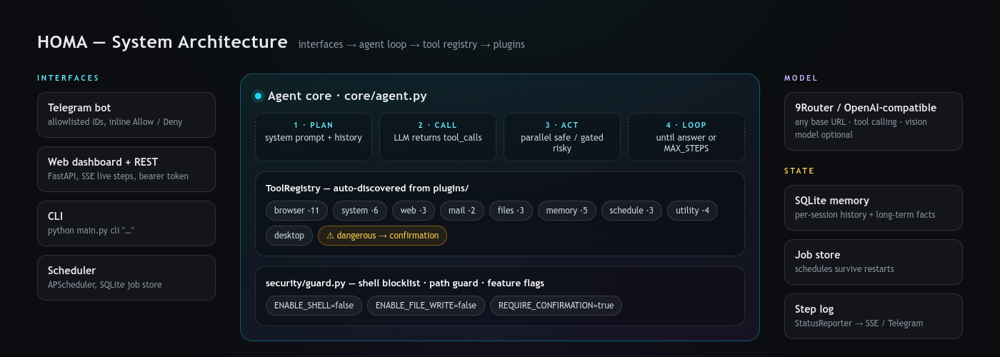

<div align="center">


# هُما — دستیار هوشمند خودران

**یک ایجنت هوش مصنوعی سِلف‌هاست که واقعاً کار می‌کند، نه اینکه فقط حرف بزند.**<br/>
مرورگر واقعی را می‌راند، سیستم شما را کنترل می‌کند، ایمیل می‌خواند، به خاطر می‌سپارد<br/>و کارها را زمان‌بندی‌شده انجام می‌دهد — از تلگرام، وب یا ترمینال.

[](LICENSE)
[](https://www.python.org/)
[](https://core.telegram.org/bots)
[](README.md)

</div>

<p align="center"></p>

---

## 🕊 هُما چیست؟

بیشتر «دستیارهای هوش مصنوعی» فقط می‌توانند حرف بزنند. **هُما عمل می‌کند.**

هُما یک ایجنت خودران است که کاملاً روی **لپ‌تاپ یا سرور خانگی خودتان** اجرا می‌شود. دستور را به زبان
ساده (فارسی یا انگلیسی) می‌دهید و او مرحله‌به‌مرحله ابزارهای واقعی را صدا می‌زند و در پایان گزارش می‌دهد
که دقیقاً چه کاری انجام داده است.

```text
شما →  «وارد پنل صورتحسابم شو، فاکتور این ماه رو دانلود کن،
         بعد بگو درایو C چقدر جا داره»

هُما → browser.goto → browser.extract_form → browser.fill_form → click(#login)
     → browser.read → files.write ⚠ (اول تأیید می‌گیرد) → system.disk_usage
     → «فاکتور ذخیره شد (۱۸۴ کیلوبایت). مبلغ ۴۱۲ یورو تا ۲۰۲۶-۰۸-۰۵.
        درایو C: ۱۱۸.۴ گیگ آزاد از ۴۷۶.۹ گیگ.»
```

| | |
|---|---|
| 🧠 **هر مدلی** | هر endpoint سازگار با OpenAI — 9Router، OpenAI، OpenRouter، Ollama، LM Studio |
| 🖥 **لوکال‌فرست** | بدون کلاد واسط و بدون تله‌متری؛ کلیدها و فایل‌ها پیش خودتان می‌ماند |
| 🔌 **افزونه‌پذیر** | یک فایل در `plugins/` بگذارید، مدل بلافاصله ابزار جدید را می‌بیند |
| 🛡 **امن به‌صورت پیش‌فرض** | شل و نوشتن فایل خاموش است؛ کارهای خطرناک تأیید می‌خواهند |
| 🌍 **دوزبانه** | فارسی و انگلیسی، با رابط‌های سازگار با راست‌به‌چپ |
| ⏰ **همیشه بیدار** | زمان‌بند پایدار؛ کارها بعد از ری‌استارت هم زنده می‌مانند |

---

## 📸 تصاویر

<table>
<tr>
<td width="58%" valign="top"><b>داشبورد وب</b> — نمایش زندهٔ مراحل، پاسخ مارک‌داون، سازگار با RTL.
</td>
<td width="42%" valign="top"><b>تلگرام</b> — همان مغز، در جیب شما، همراه دکمه‌های تأیید/رد.
</td>
</tr>
</table>

---

## ✨ توانایی‌ها

| دسته | ابزارها | نمونه دستور |
|---|---|---|
| 🌐 **مرورگر** | `goto` `read` `inspect` `extract_form` `click` `type` `fill_form` `scroll` `back` `screenshot` `connect_existing` | «این فرم رو باز کن و سؤال‌هاش رو جواب بده» |
| 🖥 **سیستم** | `disk_usage` `list_dir` `info` `processes` `open` `run_command` ⚠ | «درایو C چقدر جا داره؟» |
| 🔎 **وب** | `fetch` `search` `download` | «قیمت دلار رو از این سایت بگیر» |
| 📬 **ایمیل** | `check` `send` ⚠ | «علی برام ایمیل زده؟» |
| 📁 **فایل** | `search` `read` `write` ⚠ | «همهٔ PDFهای پوشهٔ اسناد رو پیدا کن» |
| 🧠 **حافظه** | `remember` `recall` `search` `list` `forget` | «یادت باشه آدرس خونه‌م …» |
| ⏰ **زمان‌بندی** | `add` `list` `remove` | «هر روز ۹ صبح قیمت دلار رو بفرست» |
| 🧰 **ابزار** | `clipboard` `notify.desktop` `time.now` | «این رو کپی کن تو کلیپ‌بورد» |

⚠ یعنی ابزار خطرناک: قبل از اجرا تأیید می‌گیرد.

---

## 🚀 شروع سریع

```bash
git clone https://github.com/sadult/homa.git
cd homa
python -m venv .venv && source .venv/bin/activate   # ویندوز: .venv\Scripts\activate
pip install -r requirements.txt
playwright install chromium
cp .env.example .env          # کلیدها و توکن‌ها را وارد کنید
python main.py check          # تست اتصال به مدل
python main.py both           # تلگرام + وب
```

بعد آدرس **http://127.0.0.1:8000** را باز کنید، در تنظیمات ⚙ توکن `WEB_AUTH_TOKEN` را بگذارید و شروع کنید.

### اجرا با داکر

```bash
cp .env.example .env
docker compose up -d --build
```

---

## ⚙️ تنظیمات مهم

| متغیر | پیش‌فرض | توضیح |
|---|---|---|
| `NINEROUTER_API_KEY` | — | کلید API مدل |
| `NINEROUTER_BASE_URL` | `http://localhost:20128/v1` | آدرس endpoint سازگار با OpenAI |
| `MODEL` | `gpt-4o` | مدل چت (باید tool calling داشته باشد) |
| `TELEGRAM_BOT_TOKEN` | — | توکن ربات از @BotFather |
| `ALLOWED_TELEGRAM_IDS` | — | آیدی‌های عددی مجاز |
| `WEB_AUTH_TOKEN` | `change-me` | توکن دسترسی به داشبورد و API |
| `CHROME_CDP_URL` | — | اتصال به کروم باز خودتان |
| `ENABLE_SHELL` / `ENABLE_FILE_WRITE` | `false` | فعال‌سازی ابزارهای پرخطر |
| `MAX_STEPS` | `30` | سقف مراحل هر دستور |

فهرست کامل در [`.env.example`](.env.example) و [README انگلیسی](README.md#-configuration).

---

## 🧩 معماری

<p align="center"></p>

رابط‌ها (تلگرام / وب / CLI / زمان‌بند) → حلقهٔ ایجنت → رجیستری ابزارها → افزونه‌ها.
جزئیات کامل: [`docs/ARCHITECTURE.md`](docs/ARCHITECTURE.md)

---

## 🛡 مدل امنیتی

- ابزارهای پرخطر پیش‌فرض **خاموش‌اند** و هرکدام تأیید جداگانه می‌خواهند.
- بلاک‌لیست دستورات مخرب و محافظ مسیر فایل در `security/guard.py`.
- تلگرام فقط برای آیدی‌های مجاز؛ API فقط با توکن.
- سرویس روی `127.0.0.1` بالا می‌آید؛ برای دسترسی از بیرون از Tailscale یا Cloudflare Tunnel استفاده کنید.

> ⚠️ فقط روی حساب‌ها و دستگاه‌های خودتان استفاده کنید.

---

## 🪶 دربارهٔ نام

در اسطوره‌های ایرانی، **هُما** پرنده‌ای است که هرگز فرود نمی‌آید و سایه‌اش بر هرکه بیفتد خوشبخت می‌شود.
نامی مناسب برای دستیاری که در پس‌زمینه در پرواز است و کارها را بی‌سروصدا پیش می‌برد.

**H**ands-**O**n **M**achine **A**ssistant

---

## 📄 لایسنس

[PolyForm Noncommercial 1.0.0](LICENSE) — رایگان برای استفادهٔ شخصی، پژوهشی و آموزشی. استفادهٔ تجاری نیاز به لایسنس جداگانه دارد.

> Required Notice: Copyright (c) 2026 Mersad Shahidi
