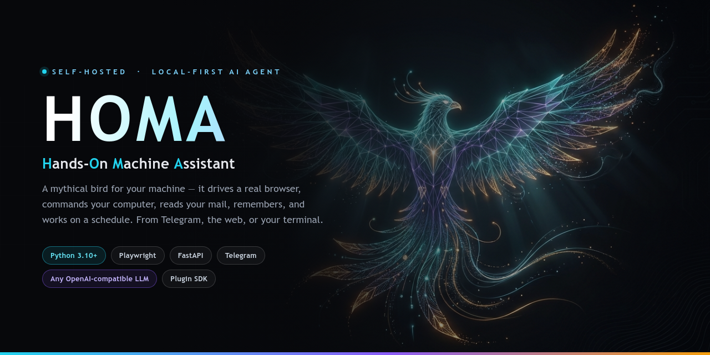
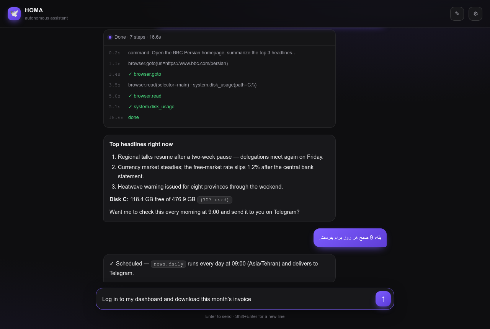
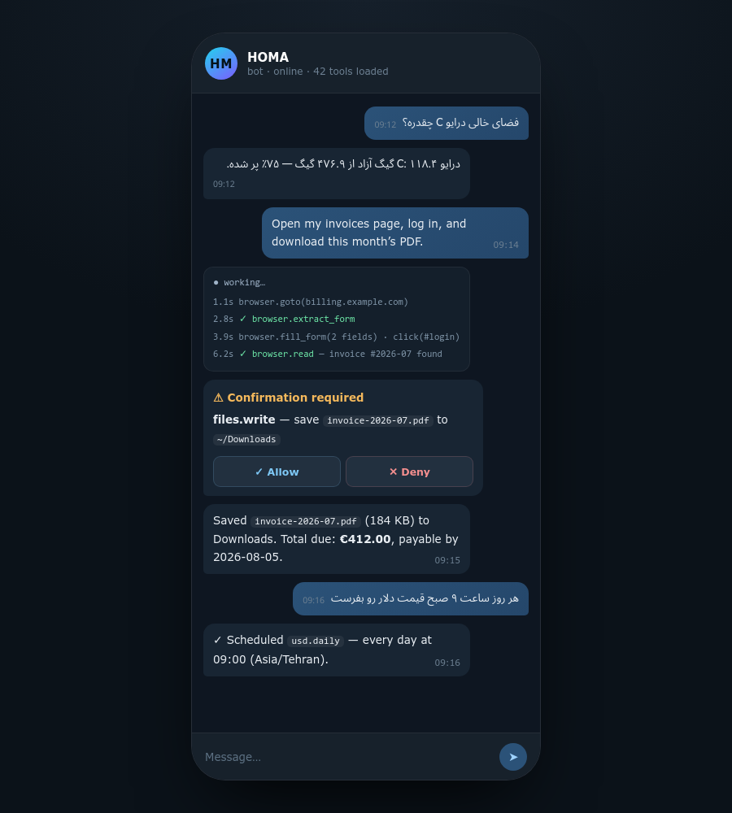
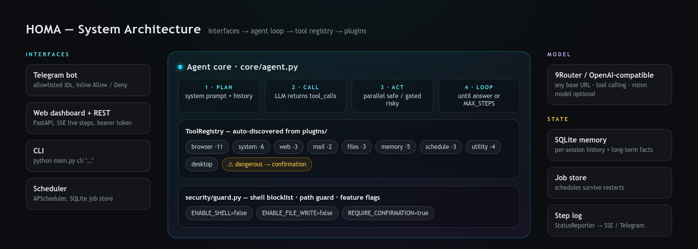

<div align="center">


# HOMA — Hands-On Machine Assistant

**A self-hosted, local-first AI agent that actually touches your machine.**<br/>
It drives a real browser, commands your computer, reads your mail, remembers what matters,<br/>and works on a schedule — from Telegram, a web dashboard, or your terminal.

[](LICENSE)
[](https://www.python.org/)
[](https://fastapi.tiangolo.com/)
[](https://playwright.dev/)
[](https://core.telegram.org/bots)
[](#-configuration)

[](../../actions)
[](https://docs.astral.sh/ruff/)
[](#-run-with-docker)
[](#-security-model)
[](CONTRIBUTING.md)
[](#-about-the-name)

[**Quick start**](#-quick-start) · [**Features**](#-what-it-can-do) · [**Architecture**](#-architecture) · [**Plugins**](#-write-a-plugin-in-20-lines) · [**API**](#-rest-api) · [**Security**](#-security-model) · [**Roadmap**](docs/ROADMAP.md) · [**فارسی**](README.fa.md)

</div>

<p align="center">
  
</p>

---

## 🕊 What is HOMA?

Most "AI assistants" can only talk. **HOMA acts.**

HOMA is an autonomous agent that runs entirely on **your own laptop or home server**. You give it a
command in plain Persian or English — from Telegram, a browser tab, or a shell — and it plans, calls
real tools step by step, and reports back what it actually did.

```text
you →  "log in to my billing dashboard, download this month's invoice,
         then tell me how much free space is left on drive C"

HOMA → browser.goto → browser.extract_form → browser.fill_form → click(#login)
     → browser.read → files.write ⚠ (asks you first) → system.disk_usage
     → "Saved invoice-2026-07.pdf (184 KB). €412.00 due 2026-08-05.
        Drive C: 118.4 GB free of 476.9 GB."
```

| | |
|---|---|
| 🧠 **Any model, any provider** | Anything OpenAI-compatible — [9Router](https://9router.ai), OpenAI, OpenRouter, Ollama, LM Studio, vLLM. Change one URL. |
| 🖥 **Local-first by design** | No agent cloud, no telemetry. Your keys, your browser profile, your files — all on your machine. |
| 🔌 **Plugin-native** | Drop a `.py` file in `plugins/` and the model instantly sees the new tools. No core changes. |
| 🛡 **Guarded by default** | Shell and file-writes are off; dangerous tools need an explicit Allow. |
| 🌍 **Bilingual** | Understands and answers in Persian or English, with RTL-aware interfaces. |
| ⏰ **Always on** | Persistent scheduler keeps jobs alive across restarts. |

---

## 📸 Screenshots

<table>
<tr>
<td width="58%" valign="top">
<b>Web dashboard</b> — live step streaming over SSE, markdown answers, RTL/LTR aware, one-click memory reset.

</td>
<td width="42%" valign="top">
<b>Telegram</b> — same brain in your pocket, with inline <i>Allow / Deny</i> confirmation for risky actions.

</td>
</tr>
</table>

---

## ✨ What it can do

Every capability is a **tool**; every tool comes from an auto-loaded plugin. Out of the box:

| Category | Tools | Ask it like this |
|---|---|---|
| 🌐 **browser** | `goto` `read` `inspect` `extract_form` `click` `type` `fill_form` `scroll` `back` `screenshot` `connect_existing` | *"Open this survey and answer the questions"* · *"Log in and read my messages"* |
| 🖥 **system** | `disk_usage` `list_dir` `info` `processes` `open` `run_command` ⚠ | *"How much free space on drive C?"* · *"Open the Downloads folder"* |
| 🔎 **web** | `fetch` `search` `download` | *"Check that site for the dollar rate"* · *"Search the news about X"* |
| 📬 **mail** | `check` `send` ⚠ | *"Did Ali email me?"* · *"Reply to that message"* |
| 📁 **files** | `search` `read` `write` ⚠ | *"Find every PDF in Documents from last month"* |
| 🧠 **memory** | `remember` `recall` `search` `list` `forget` | *"Remember my home address is …"* |
| ⏰ **schedule** | `add` `list` `remove` | *"Every day at 9am send me the USD price"* |
| 🧰 **utility** | `clipboard.get/set` `notify.desktop` `time.now` | *"Copy this to my clipboard"* · *"Pop a reminder on screen"* |
| 🖱 **desktop** | window & app helpers | *"Bring Chrome to the front"* |

⚠ = marked **dangerous**: requires explicit confirmation (and a feature flag) before it runs.

### 🏁 The flagship flow: *"open a page, then just handle it"*

1. Open the page yourself in **your own Chrome** (`browser.connect_existing`) or let HOMA open it (`browser.goto`).
2. Say *"answer the questions"* / *"fill this form"*.
3. HOMA calls `browser.extract_form` to read every question, its options **and its real selectors** — it never invents selectors.
4. The model decides the answers, `browser.fill_form` writes them, then it clicks next/submit and reports the result.

---

## 🚀 Quick start

> **Requirements:** Python 3.10+, ~500 MB for Chromium, and an OpenAI-compatible endpoint.

```bash
git clone https://github.com/sadult/homa.git
cd homa

python -m venv .venv
source .venv/bin/activate          # Windows: .venv\Scripts\activate

pip install -r requirements.txt
playwright install chromium

cp .env.example .env               # then edit .env (API key, tokens…)
python main.py check               # verify the model endpoint 👌
python main.py both                # Telegram bot + web dashboard
```

Open **http://127.0.0.1:8000**, paste your `WEB_AUTH_TOKEN` in ⚙ Settings, and start commanding.

<details>
<summary><b>Run modes</b></summary>

```bash
python main.py both                      # Telegram + web  (default)
python main.py web                       # web dashboard + REST API only
python main.py telegram                  # Telegram bot only
python main.py cli "open example.com and tell me the title"
python main.py check                     # diagnose the LLM endpoint, list model ids
```
</details>

### 🐳 Run with Docker

```bash
cp .env.example .env
docker compose up -d --build
docker compose logs -f
```

The image ships Chromium and its system dependencies; `homa.db` and `downloads/` are mounted as volumes so memory and schedules survive rebuilds.

---

## ⚙️ Configuration

All settings live in `.env` (see [`.env.example`](.env.example)) and are validated by `config.py`.

| Variable | Default | What it does |
|---|---|---|
| `NINEROUTER_API_KEY` | — | API key for your OpenAI-compatible endpoint |
| `NINEROUTER_BASE_URL` | `http://localhost:20128/v1` | Base URL of the model gateway (9Router, OpenAI, Ollama, …) |
| `MODEL` | `gpt-4o` | Chat model id — **must support tool calling** |
| `VISION_MODEL` | `gpt-4o` | Model used for screenshot understanding |
| `LLM_TIMEOUT` | `90` | Seconds before a model call is abandoned |
| `TELEGRAM_BOT_TOKEN` | — | Token from [@BotFather](https://t.me/BotFather) |
| `ALLOWED_TELEGRAM_IDS` | — | Comma-separated numeric ids allowed to talk to the bot |
| `WEB_HOST` / `WEB_PORT` | `127.0.0.1` / `8000` | Where the dashboard + REST API listen |
| `WEB_AUTH_TOKEN` | `change-me` | Bearer token required by every `/api/*` call |
| `HEADLESS` | `true` | Run Playwright Chromium headless |
| `CHROME_CDP_URL` | — | Attach to your own Chrome, e.g. `http://127.0.0.1:9222` |
| `ENABLE_SYSTEM_TOOLS` | `true` | Expose system inspection tools |
| `ENABLE_SHELL` | `false` | Allow `system.run_command` |
| `ENABLE_FILE_WRITE` | `false` | Allow `files.write` |
| `REQUIRE_CONFIRMATION` | `true` | Ask before every dangerous tool |
| `MAX_STEPS` | `30` | Hard ceiling on tool-calling iterations per command |
| `DB_PATH` | `homa.db` | SQLite file for history, facts and jobs |
| `IMAP_*` / `SMTP_*` | — | Mailbox credentials (app passwords recommended) |

<details>
<summary><b>Use a different provider</b></summary>

```dotenv
# OpenAI
NINEROUTER_BASE_URL=https://api.openai.com/v1
MODEL=gpt-4o-mini

# Ollama (local)
NINEROUTER_BASE_URL=http://localhost:11434/v1
MODEL=qwen2.5:14b-instruct

# OpenRouter
NINEROUTER_BASE_URL=https://openrouter.ai/api/v1
MODEL=anthropic/claude-3.5-sonnet
```
Smaller models are dramatically faster for agent loops — just make sure tool calling is supported.
</details>

---

## 🧩 Architecture

<p align="center"></p>

**Request lifecycle**

1. An interface (Telegram / web / CLI / scheduled job) receives a natural-language command.
2. `Agent.run` pulls recent history from SQLite and builds the message list with the system prompt.
3. The LLM is called with the **full JSON-schema tool catalog** generated from `ToolRegistry`.
4. Returned `tool_calls` are dispatched — read-only tools run **concurrently**, dangerous ones run one
   at a time behind a confirmation callback.
5. Results are appended and the loop repeats until a final answer (or `MAX_STEPS`).
6. The answer plus a timestamped step log go back to the interface and into memory.

Full details: [`docs/ARCHITECTURE.md`](docs/ARCHITECTURE.md).

```text
homa/
├─ main.py                # entry point: telegram | web | both | cli | check
├─ config.py              # .env-driven, pydantic-validated settings
├─ core/
│  ├─ agent.py            # the tool-calling loop
│  ├─ llm.py              # OpenAI-compatible client
│  ├─ memory.py           # SQLite history + long-term facts
│  ├─ scheduler.py        # APScheduler with a persistent job store
│  ├─ plugin_loader.py    # auto-discovers everything in plugins/
│  └─ logger.py           # StatusReporter → live step stream
├─ tools/registry.py      # Tool + ToolRegistry (+ OpenAI schema export)
├─ plugins/               # 🔌 drop a file here to add capabilities
├─ security/guard.py      # shell blocklist, path guard, feature flags
├─ interfaces/
│  ├─ telegram_bot.py
│  └─ web/                # FastAPI server + single-file dashboard
├─ docs/                  # architecture · setup · plugins · api · roadmap
└─ assets/                # brand + screenshots
```

---

## 🔌 Write a plugin in 20 lines

Create `plugins/weather.py` — that's the whole integration story:

```python
import httpx
from tools.registry import Tool, ToolRegistry


async def weather(city: str) -> dict:
    async with httpx.AsyncClient(timeout=20) as client:
        r = await client.get("https://wttr.in/" + city, params={"format": "3"})
    return {"report": r.text.strip()}


def register(registry: ToolRegistry) -> None:
    registry.register(Tool(
        name="weather.now",
        description="Get the current weather for a city.",
        parameters={
            "type": "object",
            "properties": {"city": {"type": "string", "description": "City name"}},
            "required": ["city"],
        },
        handler=weather,
        category="weather",
    ))
```

Restart HOMA and ask *"what's the weather in Tehran?"* — the model discovers the tool by itself.
Conventions, `dangerous=True`, and context-budget tips: [`docs/PLUGINS.md`](docs/PLUGINS.md).

---

## 🛰 REST API

Every endpoint requires `Authorization: <WEB_AUTH_TOKEN>` (a bare token or `Bearer <token>`).

| Method | Endpoint | Purpose |
|---|---|---|
| `POST` | `/api/command` | Run a command, get `{ result, steps }` when finished |
| `POST` | `/api/stream` | Same, streamed as SSE: `{type:"step"}` … `{type:"final"}` |
| `POST` | `/api/forget` | Clear a session's conversation memory |
| `GET` | `/api/tools` | List loaded tool categories and total count |
| `GET` | `/` | The dashboard |

```bash
curl -N http://127.0.0.1:8000/api/stream \
  -H "Authorization: $WEB_AUTH_TOKEN" -H 'Content-Type: application/json' \
  -d '{"command":"how much free space is on drive C?","session":"cli","auto_confirm":false}'
```

Because the brain lives behind this API, a mobile app is just a thin client — see [`docs/API.md`](docs/API.md).

---

## 🛡 Security model

HOMA is deliberately paranoid, because it holds real keys to a real machine.

- **Deny by default.** `ENABLE_SHELL` and `ENABLE_FILE_WRITE` are `false`; the tools simply don't run.
- **Confirmation gate.** `system.run_command`, `files.write` and `mail.send` are `dangerous=True`:
  Telegram shows inline **Allow / Deny**, the web UI has an explicit *auto-confirm* switch.
- **Blocklist + path guard.** `security/guard.py` rejects destructive commands and out-of-bounds paths
  even when the flags are on.
- **Identity checks.** Telegram is limited to `ALLOWED_TELEGRAM_IDS`; every REST call needs the bearer token.
- **Bind locally.** Default host is `127.0.0.1`. Expose it through **Tailscale** or a **Cloudflare Tunnel** —
  never raw-port-forward HOMA to the internet.
- **Secrets stay local.** `.env`, `homa.db`, screenshots and downloads are git-ignored.

Found a vulnerability? Please read [`SECURITY.md`](SECURITY.md) instead of opening a public issue.

> ⚠️ **Use HOMA on accounts and machines you own.** It is a personal automation tool — not a way to
> bypass other people's systems, exams, paywalls, CAPTCHAs, or terms of service.

---

## 🧯 Troubleshooting

| Symptom | Fix |
|---|---|
| `FAILED — cannot connect` from `main.py check` | The gateway isn't running, or `NINEROUTER_BASE_URL` is wrong. A VPN that captures all traffic must exclude `localhost`. |
| `HTTP 401` from the model | Wrong `NINEROUTER_API_KEY`. |
| `MODEL is not in the list` | Copy an exact model id printed by `python main.py check`. |
| Playwright errors on first run | Re-run `playwright install chromium`. |
| Telegram says *Not authorized* | Add your numeric id to `ALLOWED_TELEGRAM_IDS` (get it from [@userinfobot](https://t.me/userinfobot)). |
| `401` on `/api/*` | The `Authorization` header must equal `WEB_AUTH_TOKEN`. |
| Agent stops early | Raise `MAX_STEPS`, or switch to a stronger tool-calling model. |
| It replays old commands after a crash | Already handled — the bot polls with `drop_pending_updates=True`. |

More: [`docs/TROUBLESHOOTING.md`](docs/TROUBLESHOOTING.md).

---

## 🗺 Roadmap

| | Milestone | Status |
|---|---|---|
| v1.0 | Agent core, plugin system, browser/system/web/mail/files/memory/schedule, Telegram + Web | ✅ shipped |
| v1.1 | Live SSE step streaming in the dashboard | ✅ shipped |
| v1.2 | Vision fallback — screenshot → model for pages that resist text parsing | 🚧 in progress |
| v1.3 | Voice notes on Telegram (Whisper → agent) | 📋 planned |
| v1.4 | Multi-profile sessions and parallel browser contexts | 📋 planned |
| v2.0 | Mobile client over the REST API | 🔭 exploring |
| v2.1 | Push notifications for scheduled jobs | 🔭 exploring |
| v2.2 | Plugin marketplace + hot reload | 🔭 exploring |

Details and design notes: [`docs/ROADMAP.md`](docs/ROADMAP.md).

---

## ❓ FAQ

<details><summary><b>Does anything leave my machine?</b></summary><br/>
Only what you send to your model endpoint. Point it at a local runtime (Ollama, LM Studio, vLLM) and HOMA becomes fully offline.
</details>

<details><summary><b>Can it use my logged-in browser sessions?</b></summary><br/>
Yes. Launch Chrome with <code>--remote-debugging-port=9222</code>, set <code>CHROME_CDP_URL</code>, and HOMA attaches to your real profile with <code>browser.connect_existing</code> — no re-login, no stored passwords.
</details>

<details><summary><b>Which models work best?</b></summary><br/>
Anything with solid tool calling: GPT-4o / 4.1-mini, Claude 3.5+, Qwen 2.5 32B+, Llama 3.3 70B. Small models tend to invent selectors and stop mid-task.
</details>

<details><summary><b>Can I run it on a Raspberry Pi or home server?</b></summary><br/>
Yes — headless mode plus the Docker image are designed for exactly that. Reach it privately over Tailscale.
</details>

<details><summary><b>Is it multi-user?</b></summary><br/>
Sessions are isolated in memory, but HOMA is meant as a personal agent. Multi-profile isolation lands in v1.4.
</details>

---

## 🤝 Contributing

Issues, plugin PRs, and docs improvements are very welcome — start with [`CONTRIBUTING.md`](CONTRIBUTING.md)
and the [Code of Conduct](CODE_OF_CONDUCT.md).

```bash
pip install -r requirements-dev.txt
make lint    # ruff
make test    # pytest
```

---

## 🪶 About the name

In Persian myth, the **Homa** (هُما) is a bird that never lands — it lives its whole life in flight, and
whoever falls under its shadow is destined for fortune. It felt like the right name for an assistant
that stays airborne in the background and quietly makes your day easier.

**H**ands-**O**n **M**achine **A**ssistant.

---

## 📄 License

[PolyForm Noncommercial License 1.0.0](LICENSE) — free for personal, hobby, research, educational and
other noncommercial use. Commercial use requires a separate license.

> Required Notice: Copyright (c) 2026 Mersad Shahidi

<div align="center">
<br/>
<sub>Built with 🕊 by <b>Mersad Shahidi</b> · If HOMA saves you time, consider leaving a ⭐</sub>
</div>
