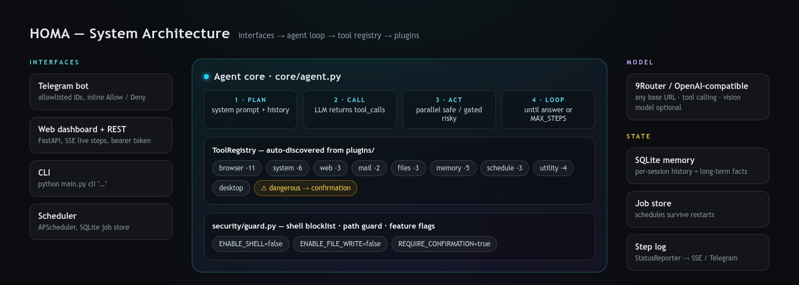

# Architecture

<p align="center"></p>

HOMA is four layers with one rule between them: **the core never knows what a tool does.**

```text
  Telegram ─┐
  Web UI   ─┼── command ──►  Agent loop  ──►  LLM (OpenAI-compatible)
  CLI      ─┬            (core/agent.py) ◄──  tool_calls
  Scheduler─┘                   │
                                ▼
                          ToolRegistry  ◄── plugins/* (auto-discovered)
                                │
   browser · system · web · mail · files · memory · schedule · utility · desktop
```

## 1. Interfaces

| Interface | File | Notes |
|---|---|---|
| Telegram | `interfaces/telegram_bot.py` | Allowlisted user ids, inline **Allow / Deny** keyboards, live step edits |
| Web + REST | `interfaces/web/server.py` | FastAPI, bearer token, SSE streaming, single-file dashboard |
| CLI | `main.py cli "…"` | One-shot execution, auto-confirms (you are already at the keyboard) |
| Scheduler | `core/scheduler.py` | APScheduler jobs that call the same `Agent.run` |

All four produce the same thing: a string command plus a confirmation callback.

## 2. Agent loop (`core/agent.py`)

1. Build messages: system prompt + recent session history + the new command.
2. Ask the model with `registry.openai_schema()` — every tool as a JSON-schema function.
3. No `tool_calls`? That's the final answer: store it and return.
4. Otherwise split the calls:
   - **safe** tools run concurrently with `asyncio.gather`,
   - **dangerous** tools run one at a time, each behind `confirm_cb(name, args)`.
5. Append results in the model's original call order (the API requires it) and loop.
6. Stop at `MAX_STEPS` with an explicit "step limit reached" message rather than silently truncating.

Every action is pushed to a `StatusReporter`, which is what the UI streams and Telegram edits in place.

## 3. Tool registry (`tools/registry.py`)

```python
@dataclass
class Tool:
    name: str            # "browser.goto"
    description: str     # written for the model
    parameters: dict     # JSON Schema
    handler: Callable    # async, kwargs match the schema
    dangerous: bool = False
    category: str = "general"
```

`core/plugin_loader.py` imports every module in `plugins/` and calls its `register(registry)`.
Adding a capability therefore never touches the agent — the schema regenerates itself and the model
sees the new tool on the next run.

## 4. State

| Concern | Where | Behaviour |
|---|---|---|
| Conversation history | SQLite via `core/memory.py` | Per-session, trimmed to a recent window |
| Long-term facts | Same DB | Written by `memory.remember`, retrieved by `recall` / `search` |
| Scheduled jobs | APScheduler SQLite job store | Survive restarts and crashes |
| Step logs | In-memory `StatusReporter` | Streamed live, returned with each response |

## 5. Security layer (`security/guard.py`)

A thin, deliberately boring gate that sits between tools and the OS:
feature flags (`ENABLE_SHELL`, `ENABLE_FILE_WRITE`), a destructive-command blocklist, and path
validation. Anything the model can trigger that changes state also carries `dangerous=True`, so it
meets the confirmation callback before the guard ever runs.

## Design decisions worth knowing

- **Plugins over configuration.** New capability = new file. No registry edits, no core churn.
- **The model never guesses selectors.** The prompt forces `inspect` / `extract_form` before acting,
  which is the single biggest reliability win in browser automation.
- **Parallel reads, serial writes.** Cheap on latency, safe on side effects.
- **Everything is resumable.** State lives in SQLite, so a crash costs you one command, not your setup.
- **The API is the product boundary.** Telegram, web and a future mobile app are all thin clients.
